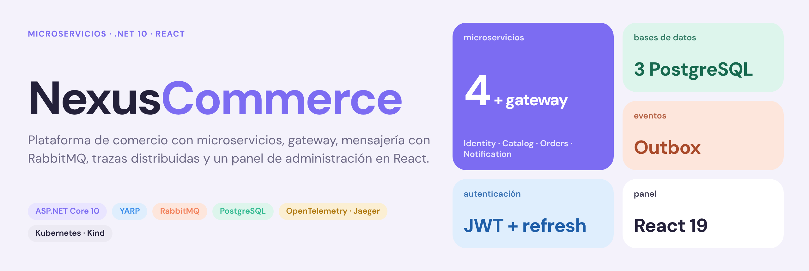
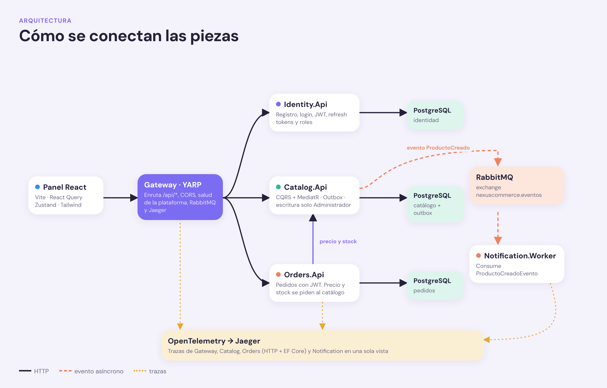
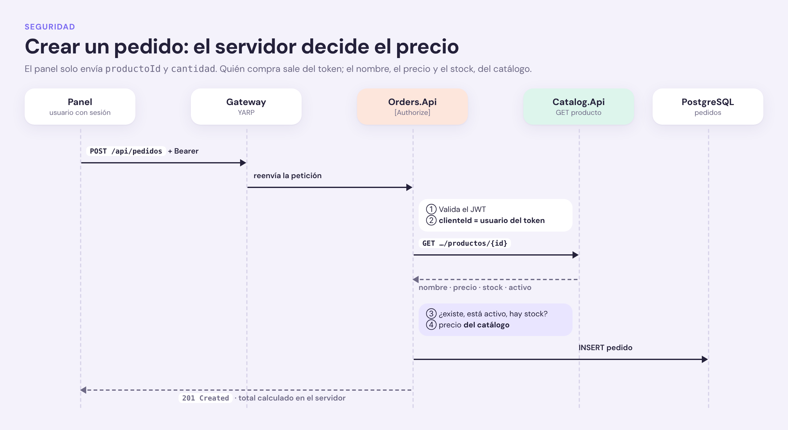
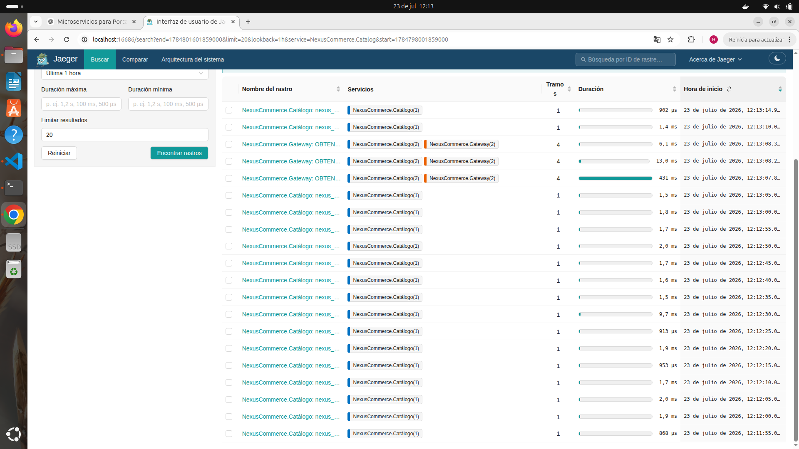
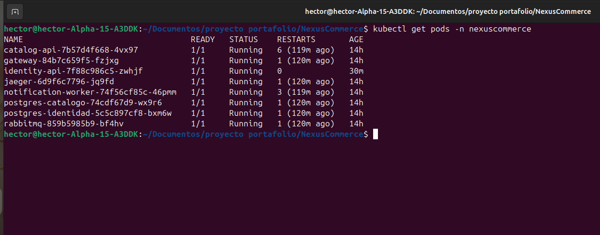

<p align="center">
  
</p>

<p align="center">
  <a href="https://github.com/hectormac35/NexusCommerce/actions/workflows/ci.yml"></a>
  
  
  
  
</p>

**NexusCommerce** es una plataforma de comercio construida como **microservicios en ASP.NET Core 10**. Cada servicio tiene su propia base de datos PostgreSQL. Todos se publican detrás de un **gateway YARP**, los eventos viajan por **RabbitMQ** con el patrón *Transactional Outbox* y las trazas se ven en **Jaeger**. Se administra desde un **panel en React 19**.

| Servicio | Qué hace |
|---|---|
| **Gateway** (YARP) | Punto de entrada único (`/api/*`), CORS y endpoints de salud de la plataforma, RabbitMQ y Jaeger para el panel |
| **Identity.Api** | Registro, login, JWT con *refresh tokens* rotatorios y roles (Cliente, Empleado, Administrador) |
| **Catalog.Api** | Productos con CQRS + MediatR y validación FluentValidation. Publica `ProductoCreadoEvento` mediante Outbox |
| **Orders.Api** | Pedidos con su ciclo de estados. Precio y stock se consultan al catálogo en el servidor |
| **Notification.Worker** | Consume los eventos de RabbitMQ |
| **Panel web** | React 19 + Vite, React Query, Zustand y Tailwind. Registro, rutas protegidas por sesión y por rol, carga por página |

---

## Arquitectura

<p align="center"></p>

Cada microservicio sigue **Clean Architecture** (Domain → Application → Infrastructure → Api). Los servicios no comparten base de datos: Orders pregunta al catálogo por HTTP y el catálogo avisa de los cambios con eventos.

---

## Seguridad de los pedidos

<p align="center"></p>

| Regla | Cómo se aplica |
|---|---|
| Hay que iniciar sesión | `[Authorize]` en todo `Orders.Api`, con el mismo JWT que emite Identity |
| Nadie compra en nombre de otro | El cliente del pedido sale del token, no del cuerpo de la petición |
| El precio no lo decide el navegador | Nombre, precio, stock y estado del producto se leen de `Catalog.Api` |
| Cada uno ve lo suyo | Un cliente solo lista y abre sus pedidos. Un pedido ajeno responde `404` |
| Estados solo para administradores | `PATCH /api/pedidos/{id}/estado` exige el rol Administrador. Una transición no válida devuelve `400`, no `500` |

---

## Panel de administración

> Capturas del panel funcionando con `docker compose` (se añaden en `docs/images/`).

---

## Observabilidad

<p align="center"></p>

Gateway, Catalog, Orders y Notification exportan trazas con OpenTelemetry (OTLP) a Jaeger. Así se puede seguir una petición del panel a través de todos los servicios, incluidas las consultas a PostgreSQL que hace EF Core.

---

## Ponerlo en marcha

**Requisitos:** Docker con Compose v2 y Node.js 22 para el panel.

```bash
git clone https://github.com/hectormac35/NexusCommerce.git
cd NexusCommerce
docker compose up -d --build        # 5 servicios .NET + 3 PostgreSQL + RabbitMQ + Jaeger

cd src/Frontend/NexusCommerce.Web
npm ci
npm run dev                         # http://localhost:5173
```

Entra con el **administrador de demo** que se crea al primer arranque: `admin@nexuscommerce.local` / `Admin.Nexus2026!`.
Cualquiera puede **crear una cuenta** desde la pantalla de acceso; empieza como *Cliente* y el administrador le asigna otro rol en **Usuarios**.

| Dirección | Qué hay |
|---|---|
| http://localhost:5173 | Panel web |
| http://localhost:5080 | Gateway (todas las APIs bajo `/api/...`) |
| http://localhost:16686 | Jaeger |
| http://localhost:15672 | RabbitMQ (`nexus` / `nexus_rabbit_password`) |
| :5101 · :5201 · :5301 | Catalog, Identity y Orders directamente |

<details>
<summary><b>Kubernetes con Kind</b></summary>

```bash
./k8s/desplegar-kind.sh
```

Crea el clúster si no existe, construye y carga las cinco imágenes y aplica `k8s/base` con Kustomize. El gateway queda en http://localhost:5080 y Jaeger en http://localhost:16686.

<p align="center"></p>
</details>

---

## Tests y CI

| Proyecto | Qué cubre |
|---|---|
| `Catalog.Domain.UnitTests` | Reglas del producto y tipo `Resultado` |
| `Catalog.Application.UnitTests` | Comandos de crear, actualizar y desactivar, con sus validadores |
| `Catalog.Api.IntegrationTests` | Endpoints reales contra PostgreSQL y JWT de prueba |
| `Identity.Domain.UnitTests` | Usuarios, credenciales y refresh tokens |
| `Orders.Domain.UnitTests` | Ciclo de vida del pedido |
| `Orders.Application.UnitTests` | Precio desde el catálogo, stock, productos inactivos, catálogo caído, validación |
| Panel (Vitest) | Rutas protegidas, registro (validación + inicio de sesión automático) y que el pedido no envíe cliente ni precio |

```bash
dotnet test                                          # backend (Catalog.Api.IntegrationTests necesita PostgreSQL en :55432)
cd src/Frontend/NexusCommerce.Web && npm test        # panel
```

GitHub Actions ejecuta en cada push y PR a `main`: `dotnet format`, build y tests con PostgreSQL de servicio; lint, tests y build del panel; y la construcción de todas las imágenes Docker.

---

## Límites conocidos

- **Credenciales de desarrollo** en `docker-compose.yml` y `k8s/base/secrets.yaml` para que la demo arranque sin pasos previos. En un entorno real irían en un gestor de secretos.
- **El stock no se reserva** al crear un pedido: se comprueba, pero no se descuenta. Haría falta un evento `PedidoCreado` que consuma Catalog (patrón saga).
- **Orders aún no publica eventos**: solo Catalog usa el Outbox.

<sub>Proyecto de portfolio de <b>Héctor Macarrilla</b> · .NET · Microservicios · DevOps</sub>
